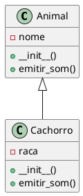

<div align="center">

# UML POO — de código Python para diagrama de classes

**Utilitário que lê código Python orientado a objetos e gera automaticamente o diagrama de classes UML em PlantUML, direto de um notebook Jupyter.**


</div>

## Sumário

- [Sobre o projeto](#sobre-o-projeto)
- [Como funciona](#como-funciona)
- [Como usar](#como-usar)
- [Exemplo](#exemplo)
- [API do módulo](#api-do-módulo)
- [Limitações conhecidas](#limitações-conhecidas)
- [Próximos passos](#próximos-passos)
- [Autor](#autor)

## Sobre o projeto

Desenhar diagramas de classes à mão é trabalhoso e fica desatualizado assim que o código muda. O **UML POO** automatiza esse passo: você informa o código-fonte Python e recebe o diagrama de classes correspondente, com classes, atributos, métodos e relações de **herança**.

O módulo foi criado como apoio aos estudos de **Programação Orientada a Objetos** e usa apenas a biblioteca padrão do Python para a análise do código, além do PlantUML para desenhar o resultado.

## Como funciona

1. O código Python é analisado com o módulo `ast` (árvore sintática abstrata), sem ser executado.
2. Para cada classe, são extraídos o nome, os métodos, os atributos acessados por `self` e as classes-base (herança).
3. Esses dados são convertidos em texto PlantUML (`@startuml` … `@enduml`).
4. O texto é salvo em um arquivo `.puml`, o `plantuml.jar` gera a imagem `.png` e ela é exibida no notebook.

## Como usar

### Pré-requisitos

- Python 3 e [Jupyter](https://jupyter.org/) (o módulo usa `IPython.display` para mostrar a imagem)
- [Java](https://www.java.com/) instalado e disponível no terminal (`java -version`)
- O arquivo [`plantuml.jar`](https://plantuml.com/download) na mesma pasta em que o notebook será executado

```bash
git clone https://github.com/f3lipecostadev/uml_poo.git
cd uml_poo
pip install ipython jupyter
# baixe o plantuml.jar em https://plantuml.com/download e coloque nesta pasta
jupyter notebook
```

Em um notebook novo, na mesma pasta do projeto:

```python
from utilidades_uml import gerar_diagrama_python

codigo = '''
class Animal:
    def __init__(self, nome):
        self.nome = nome

    def emitir_som(self):
        pass


class Cachorro(Animal):
    def __init__(self, nome, raca):
        super().__init__(nome)
        self.raca = raca

    def emitir_som(self):
        return "Au au"
'''

gerar_diagrama_python("diagrama_animais", codigo)
```

O notebook imprime o PlantUML gerado e exibe a imagem. Os arquivos `diagrama_animais.puml` e `diagrama_animais.png` ficam salvos na pasta atual.

## Exemplo

Para o código acima, o módulo produz o seguinte PlantUML:



Atributos aparecem com `-` (privado) e métodos com `+` (público). A herança é representada por `Animal <|-- Cachorro`.

## API do módulo

| Função | Descrição |
| --- | --- |
| `python_para_plantuml(codigo_python)` | Recebe uma `str` com código Python e **retorna** o texto PlantUML. Não depende do Java, então serve para testar a análise isoladamente. |
| `gerar_diagrama(nome_arquivo, codigo_uml)` | Salva `<nome_arquivo>.puml`, executa `java -jar plantuml.jar` e exibe `<nome_arquivo>.png`. |
| `gerar_diagrama_python(nome_arquivo, codigo_python)` | Atalho que combina as duas funções acima e imprime o PlantUML gerado. |

## Limitações conhecidas

- São analisadas apenas as classes declaradas no nível principal do código informado.
- Os atributos são inferidos a partir de qualquer acesso a `self.<nome>` dentro dos métodos. Por isso, chamadas como `self.metodo()` também aparecem na lista de atributos.
- A herança é detectada apenas quando a classe-base é um nome simples (`class B(A)`).
- Tipos, parâmetros dos métodos, visibilidade real (`_` e `__`) e associações entre classes (composição e agregação) ainda não são representados.
- A exibição da imagem exige um ambiente com `IPython` (como o Jupyter).

## Próximos passos

- [ ] Ler diretamente um arquivo `.py` ou uma pasta, sem precisar colar o código em uma string.
- [ ] Diferenciar atributos de método e mapear a visibilidade pelo prefixo `_`.
- [ ] Exibir parâmetros e tipos (_type hints_) nos métodos e atributos.
- [ ] Detectar composição e agregação a partir do `__init__`.
- [ ] Oferecer uma interface de linha de comando e publicar o módulo como pacote.
- [ ] Testes automatizados para a função `python_para_plantuml`.

## Autor

**Felipe Kauã de Sousa Costa** — Desenvolvedor de Software

[](https://github.com/f3lipecostadev)
[](https://www.linkedin.com/in/f3lipecosta/)
